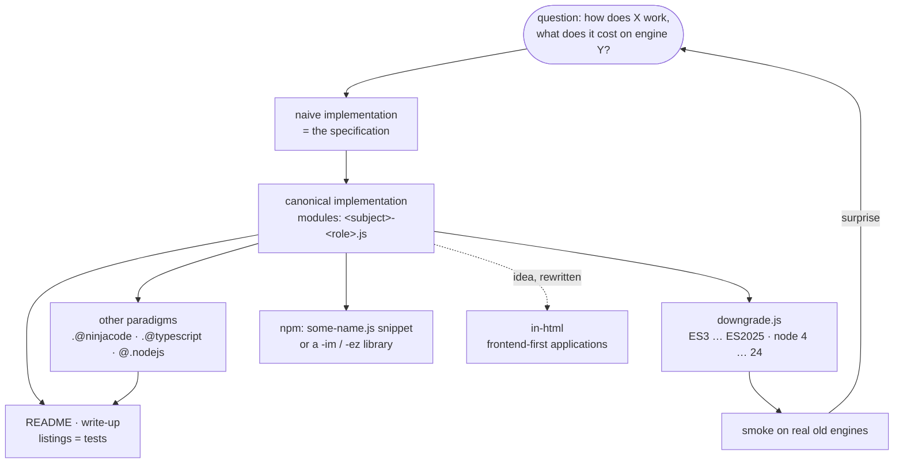
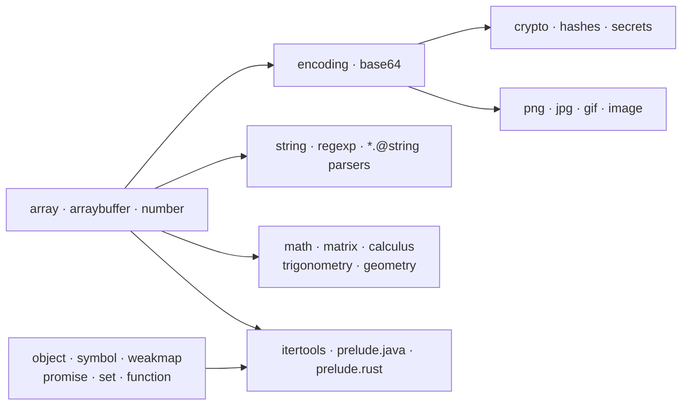
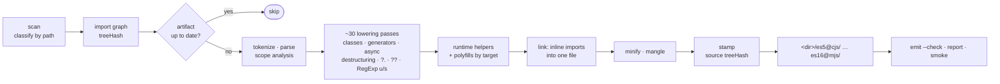

# in-javascript · all-in-one

A repository of JavaScript snippets — small, dependency-free, readable pieces
of code — and the place where they are explained.

> **Where it lives.** The origin is on Codeberg:
> [codeberg.org/slnknrr/in-javascript](https://codeberg.org/slnknrr/in-javascript) — issues, pull
> requests and releases go there.
> [github.com/slnknrr-dev/in-javascript](https://github.com/slnknrr-dev/in-javascript)
> is a code-only mirror.

> **How it is updated.** This is a lazy, catch-all repository: changes are
> collected locally and published in one batch roughly every two weeks. Do not
> expect a meaningful Git history — a commit is a snapshot, not a story.

Licensed under the [MIT License](LICENSE).

It is meant to grow into four things at once:

* **documentation** — every topic folder explains its code next to the code;
* **courses** — the folders are ordered so that one topic builds on another
  (bytes → encodings → hashes → formats), and the Markdown is written to be read
  in that order;
* **write-ups** — long-form articles with runnable listings that take one
  technique apart (start with [hashes.@crypto/DEMO_FOR_TIDE.md](https://codeberg.org/slnknrr/in-javascript/src/branch/all-in-one/hashes.@crypto/DEMO_FOR_TIDE.md));
* **artifacts** — each snippet is also shipped pre-built for old engines
  (ES3 … ES2025, node 4 … 24) as a single file you can copy anywhere.

## An R&D laboratory

This repository is a laboratory for the language. It holds:

* **ports** of data structures and algorithms from other standard libraries —
  Python `itertools` and `secrets`, Java collections, a Rust prelude;
* **original** data structures and algorithms — TIDE hashing, PRNGs, codecs,
  parsers, numerics;
* **demonstrations of the language itself** — polyfills, symbols, weak
  references, generators, the edges of RegExp and of the module system.

Code is written **naive first, canonical second, and only then in other
paradigms** (`.@ninjacode/`, `.@typescript/`, runtime-specific `@.nodejs/`).
The naive version is the specification, the canonical one is the
implementation, and the variants are experiments measured against both. Every
topic is split into small modules with one role each
(`<subject>-<role>.js`); the modules reuse each other instead of copying, and
the build inlines them back into one file per target.

The topics map onto one another the way a course does:

## How `downgrade.js` builds an artifact

Details: [README_FOR_DEVOPS.md](README_FOR_DEVOPS.md).

## The sister repository: in-html

[in-html](https://codeberg.org/slnknrr/in-html) holds the other half: web
applications, JavaScript for the browser, and the edge cases of web
development — **frontend-first**. Backend code appears here, in
in-javascript, as foundations and components; there, as the servers that
applications ship with. The JavaScript in in-html is written separately and
on purpose in a different style: plain, programmatic and moderate rather than
modular and metaprogrammed. **Beautiful JavaScript — here; a beautiful,
convenient frontend-first web — in in-html.** Browser code, its own build
(`singlefile.js`), CI/CD with artifacts on Codeberg Pages and GitHub Pages, and
a web developer's portfolio are all there.

## Machine learning

Using this repository — code, documentation, artifacts, or derivatives of
them — to train, fine-tune, evaluate or otherwise develop machine-learning
models is **not permitted without payment and the author's explicit written
consent**. A request must state the purpose and disclose the full chain: who
will use the material, for what, and every party it is passed or outsourced
to. Write to slnknrr.dev@gmail.com.

## Map

| area | folders |
|---|---|
| bytes and buffers | [arraybuffer/](https://codeberg.org/slnknrr/in-javascript/src/branch/all-in-one/arraybuffer/), [array/](https://codeberg.org/slnknrr/in-javascript/src/branch/all-in-one/array/), [encoding/](https://codeberg.org/slnknrr/in-javascript/src/branch/all-in-one/encoding/), [base64.@encoding/](https://codeberg.org/slnknrr/in-javascript/src/branch/all-in-one/base64.@encoding/) |
| numbers | [math/](https://codeberg.org/slnknrr/in-javascript/src/branch/all-in-one/math/), [number/](https://codeberg.org/slnknrr/in-javascript/src/branch/all-in-one/number/), [calculus.@math/](https://codeberg.org/slnknrr/in-javascript/src/branch/all-in-one/calculus.@math/), [matrix.@math/](https://codeberg.org/slnknrr/in-javascript/src/branch/all-in-one/matrix.@math/), [trigonometry.@math/](https://codeberg.org/slnknrr/in-javascript/src/branch/all-in-one/trigonometry.@math/), [geometry.@math/](https://codeberg.org/slnknrr/in-javascript/src/branch/all-in-one/geometry.@math/) |
| randomness and crypto | [crypto/](https://codeberg.org/slnknrr/in-javascript/src/branch/all-in-one/crypto/), [hashes.@crypto/](https://codeberg.org/slnknrr/in-javascript/src/branch/all-in-one/hashes.@crypto/), [secrets.python@3/](https://codeberg.org/slnknrr/in-javascript/src/branch/all-in-one/secrets.python@3/) |
| inline string formats | [email.@string/](https://codeberg.org/slnknrr/in-javascript/src/branch/all-in-one/email.@string/), [ip4.@string/](https://codeberg.org/slnknrr/in-javascript/src/branch/all-in-one/ip4.@string/), [ip6.@string/](https://codeberg.org/slnknrr/in-javascript/src/branch/all-in-one/ip6.@string/), [mac.@string/](https://codeberg.org/slnknrr/in-javascript/src/branch/all-in-one/mac.@string/), [html.@string/](https://codeberg.org/slnknrr/in-javascript/src/branch/all-in-one/html.@string/), [md.@string/](https://codeberg.org/slnknrr/in-javascript/src/branch/all-in-one/md.@string/), [regexp.@inline/](https://codeberg.org/slnknrr/in-javascript/src/branch/all-in-one/regexp.@inline/), [string/](https://codeberg.org/slnknrr/in-javascript/src/branch/all-in-one/string/) |
| media formats | [png.@image/](https://codeberg.org/slnknrr/in-javascript/src/branch/all-in-one/png.@image/), [jpg.@image/](https://codeberg.org/slnknrr/in-javascript/src/branch/all-in-one/jpg.@image/), [gif.@image/](https://codeberg.org/slnknrr/in-javascript/src/branch/all-in-one/gif.@image/), [image/](https://codeberg.org/slnknrr/in-javascript/src/branch/all-in-one/image/), [algorithm/](https://codeberg.org/slnknrr/in-javascript/src/branch/all-in-one/algorithm/) |
| language gaps | [symbol/](https://codeberg.org/slnknrr/in-javascript/src/branch/all-in-one/symbol/), [weakmap/](https://codeberg.org/slnknrr/in-javascript/src/branch/all-in-one/weakmap/), [object/](https://codeberg.org/slnknrr/in-javascript/src/branch/all-in-one/object/), [promise/](https://codeberg.org/slnknrr/in-javascript/src/branch/all-in-one/promise/), [set/](https://codeberg.org/slnknrr/in-javascript/src/branch/all-in-one/set/), [regexp/](https://codeberg.org/slnknrr/in-javascript/src/branch/all-in-one/regexp/), [function/](https://codeberg.org/slnknrr/in-javascript/src/branch/all-in-one/function/) |
| ports of other stdlibs | [itertools.python@3/](https://codeberg.org/slnknrr/in-javascript/src/branch/all-in-one/itertools.python@3/), [prelude.rust@1/](https://codeberg.org/slnknrr/in-javascript/src/branch/all-in-one/prelude.rust@1/), [prelude.java@6/](https://codeberg.org/slnknrr/in-javascript/src/branch/all-in-one/prelude.java@6/) |
| by paradigm / runtime | [.@ninjacode/](https://codeberg.org/slnknrr/in-javascript/src/branch/all-in-one/.@ninjacode/), [.@typescript/](https://codeberg.org/slnknrr/in-javascript/src/branch/all-in-one/.@typescript/), [@.nodejs/](https://codeberg.org/slnknrr/in-javascript/src/branch/all-in-one/@.nodejs/) |

Empty folders (`ini.@string/`, `mp3.@audio/`, `webp.@image/`, …) and empty
files are placeholders for planned topics.

## Reading the names

Folder and file names carry meaning — `png.@image/png-format.js`,
`.@ninjacode/@.nodejs/`, `es5@cjs/`. The rules are in
[CODE_STRUCTURE.md](https://codeberg.org/slnknrr/in-javascript/src/branch/all-in-one/CODE_STRUCTURE.md). In short:

* `.@<x>/` — written in dialect or paradigm *x* (`.@typescript/`, `.@ninjacode/`);
* `@.<x>/` — requires runtime *x* (`@.nodejs/`);
* `<subject>-<role>.js` — `html-escape.js`, `ip4-parse.js`, `tide-hash.js`;
* `<standard>@<modules>/` — generated artifacts; do not edit.

## Using a snippet

* **Modern code:** import the source directly — it is plain ES2025+ ESM.
* **Anything else:** copy the artifact for your engine, e.g.
  `png.@image/es5@cjs/png-format.js`. It is a single file with every import
  inlined and missing built-ins polyfilled.

## Working on the repository

The build and CI tooling is the flat set of `downgrade*.js` files in the root;
no `npm install` is needed. How to run, configure and extend it:
[README_FOR_DEVOPS.md](https://codeberg.org/slnknrr/in-javascript/src/branch/all-in-one/README_FOR_DEVOPS.md).

Roadmap and design notes (in Russian, pending translation):
[BACKLOG.md](https://codeberg.org/slnknrr/in-javascript/src/branch/all-in-one/BACKLOG.md), [DO_RECONST.md](https://codeberg.org/slnknrr/in-javascript/src/branch/all-in-one/DO_RECONST.md).
